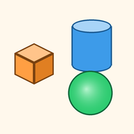

# 🎮 입체모양 게임

**상자 모양 · 둥근 기둥 모양 · 공 모양**을 찾고 나누는 도형 놀이

 

  

📱 **태블릿은 QR 코드를 카메라로 찍으면 바로 열려요**

`https://khs84.github.io/shape-playground/`

---

## 놀이 두 가지

| 놀이 | 방법 |
|---|---|
| 🔍 **모양 찾기** | 목소리가 말하는 모양을 그림 4개 중에서 찾아 눌러요. 맞히면 빨간 O표가 찍혀요. (9문제) |
| 🧺 **모양 바구니** | 그림을 같은 모양 바구니로 끌어 넣거나 바구니를 눌러요. 모양의 특징도 들려줘요. (12문제) |

- 🔊 자연스러운 목소리로 문제와 칭찬을 들려줘요. 오른쪽 위 🔊 버튼을 누르면 다시 들어요.
- ✨ 두 번 틀리면 정답이 반짝여서 누구나 끝까지 할 수 있어요.

## 📱 태블릿에서 앱처럼 쓰기

홈 화면에 추가하면 **아이콘을 눌러 전체 화면으로** 열리고, 한 번 연 뒤에는 **인터넷이 없어도** 실행돼요.

| 기기 | 방법 |
|---|---|
| 아이패드 (Safari) | 공유 버튼 <kbd>⬆</kbd> → **홈 화면에 추가** |
| 갤럭시 탭 (Chrome·삼성 인터넷) | 메뉴 <kbd>⋮</kbd> 또는 <kbd>≡</kbd> → **홈 화면에 추가** (또는 **앱 설치**) |

> 💡 소리가 안 나면 화면을 한 번 톡 누르고 기기 음량을 올려 주세요.
